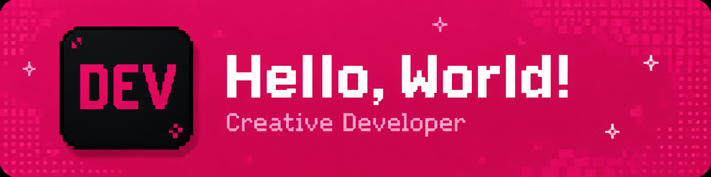

# Hi, I'm Juna 👋

  
  

## 👋 About Me

I'm **Muhammad Farhan Juna**, a **Web Designer & Frontend Developer** based in Yogyakarta, Indonesia.

I design and build polished digital experiences that combine **visual design, frontend development, motion, and thoughtful user experience**.

My work focuses on **modern websites, landing pages, SaaS interfaces, design systems, and responsive frontend experiences** with an emphasis on strong typography, layout, interaction, performance, and maintainable implementation.

I work across both **design and development**, using **Figma, Webflow, and Framer** for visual design and prototyping, alongside **React, Next.js, Vue, Nuxt, TypeScript, and Tailwind CSS** for custom frontend development.

My goal is to create websites that are not only functional, but also feel **clear, intentional, responsive, and visually refined**.

---

## ⚡ What I Do

* 🎨 Web design & visual direction
* ✨ Modern landing pages & marketing websites
* 🖥️ SaaS dashboards & web applications
* 📐 Responsive UI design & implementation
* 🎯 Figma to pixel-accurate frontend
* 🧩 Design systems & reusable components
* 🎬 Motion, interactions & micro-interactions
* ⚡ Frontend performance & responsive optimization
* 🌐 Webflow & Framer development

---

## 🛠 Tech Stack

### Design & Visual Development

  
  
  

**Web Design · UI/UX · Responsive Design · Design Systems · Prototyping · Motion · Interaction Design**

### Frontend Development

  

### Development Tools

  

---

## 🌐 Portfolio

Explore my selected work across **web design, visual websites, landing pages, SaaS interfaces, and frontend development**.

---

## 📊 GitHub Stats

  
  

  

---

## 🤝 Let's Connect

I'm open to opportunities and collaborations around **web design, creative development, landing pages, SaaS products, and design-driven digital experiences**.

  

  

  

  

---

  Designing experiences · Building interfaces · Bringing ideas to life.

